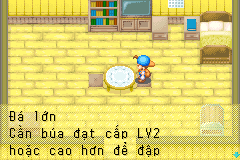
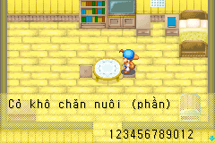

# Tương tác nông trại bị sót — 2026-10-24

Thêm 23 chuỗi ở 17 script, tổng 1.479 bản dịch nháp. Nguồn và display call
được khóa trong localization/farm_interactions.json; bản Việt nằm ở pilot.json.

- 98.000–002: máng nước và hai nhánh tìm Ngọc Sự thật/tay đầy.
- 154.000, 156.001: tổ ong và kho gỗ hết gỗ.
- 217.000, 458.000: kho/thùng hết thức ăn cho gà, giữ nội dung nguồn dù
  tên Chicken Feed trong chuồng gia súc có vẻ không phù hợp.
- 218/219.000–002: ổ ấp, trứng đã có, ổ đầy; cả hai bản sao.
- 220.000, 463.000: hướng dẫn máy mayonnaise và máy làm sợi.
- 221.000, 461.000: bảng lượng thức ăn cho gà và cỏ khô. 461 là bản sao
  bị sót trong ảnh; 163 đã dịch trước đó không tự thay được script 461.
- 459/460.000: máng ăn cho con vật mang thai.
- 969–972.000: đá khổng lồ, đá lớn và gốc cây. Giữ LV5/LV2/LV3 như nguồn,
  không thay điều kiện nâng cấp hoặc sửa sự kiện.

Không đoán địa chỉ. Verifier kiểm literal, CODE hash và native display site.
17 CODE/JUMP giữ nguyên; English typo `Sone` cũng giữ nguyên trong nguồn.
Bảng bộ đếm chuyển đơn vị lên tiêu đề và chừa 12 ô cho VAR, không bỏ token.

145 test ROM đạt. Hai mGBA kiểm 23 fixture/26 WAIT/61 dòng renderer, so
bitmap đủ ba hàng trước/sau cuộn. Hai bảng số lượng dùng 12 chữ số thử nghiệm;
VAR thật trong ROM được giữ nguyên. SRAM không đổi. Đây là fixture UI trong
nhà, không phải chứng nhận đã đi tới mọi vật thể bằng gameplay. Chưa duyệt
ngôn ngữ/bố cục thủ công; các nhóm tương tác chưa phân loại vẫn chờ nghiên cứu.
Không khẳng định đã dịch mọi thông báo trong toàn game.

[Báo cáo](evidence/farm-interactions-validation.json). Full-platform/golden
trước đây giữ hash lịch sử, không được coi là đã chạy lại cho ROM mới.

