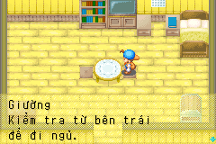
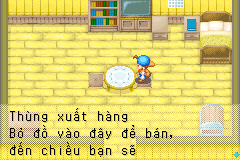
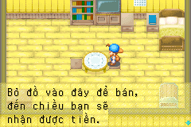

# Hướng dẫn giường và thùng xuất hàng — interaction-hints-01

Ngày 2026-10-24: Việt hóa đúng hai nội dung trong ảnh người dùng, gồm ba vị
trí chuỗi ROM. Không gộp chúng vào 261 nhãn ngắn ở object-labels-01.

| ID | Địa chỉ nguồn | Bản dịch |
| --- | --- | --- |
| script.0223.003 | 0x082D24D6 | Giường / Kiểm tra từ bên trái / để đi ngủ. |
| script.0342.003 | 0x082DADFC | Giường / Kiểm tra từ bên trái / để đi ngủ. |
| script.0464.000 | 0x082F4A3C | Thùng xuất hàng / Bỏ đồ vào đây để bán, / đến chiều bạn sẽ / nhận được tiền. |

Tên **Thùng xuất hàng** dùng lại glossary hiện có. Nguồn tiếng Anh giữ
nguyên cả lỗi chính tả `recieve`, chỉ sửa ngôn ngữ ở bản dịch. Không thêm
thời gian thu hàng hoặc người nói mà nguồn chuỗi không nêu.

## Bằng chứng nguồn và chèn lại

Nguồn được trích từ ROM USA rev 0 có SHA1
`a2fc3574f0a65a4fcf7682fb274b9d7eebdef963`, không suy đoán địa chỉ từ ảnh.
`localization/en/interaction_hints.json` giữ nguyên văn bản, byte nguồn và
source reference. Bản Việt nằm trong `localization/vi/pilot.json`.

`localization/qa/batches/interaction-hints-01.json` khóa hash CODE và vị trí
push string index → OnCall hiển thị:

- Script 223: index 3 → OnCall33 tại CODE offset 360, cờ 0x100.
- Script 342: index 3 → OnCall33 tại CODE offset 1068, cờ 0x100.
- Script 464: index 0 → OnCall35 tại CODE offset 17, cờ 0.

Verifier kiểm lại literal, hash CODE và display site; dùng lại guard handler
native của object_text. So ROM đích để xác nhận CODE/JUMP, số chuỗi và các
chuỗi không chọn trong ba script không thay đổi. Lựa chọn ngủ Yes/No và hai
câu hỏi ngủ vẫn giữ nguyên trong lô này. Nhãn `Shipment Box{RAW:81A8}` ở
script.0162.000 chưa rõ vai trò của RAW nên chưa dịch.

Giữ nguyên thứ tự CR/LF/WAIT. Thùng xuất hàng có WAIT sau dòng thứ ba rồi
cuộn thêm một dòng để hiện phần nhận tiền. Công cụ chèn hiện có relocation
STR/pointer, bảng mã Việt EB và kiểm giới hạn 28 ô; không đổi font, HUD,
icon, baseline hoặc dữ liệu gameplay.

## Kiểm thử

```bash
.venv/bin/python tools/interaction_hints_smoke.py build/fomt-vi-demo.gba \
  --base-rom "$FOMT_ROM" --library build/mgba_bridge-0.10.5.so
make platform-emulator ROM="$FOMT_ROM" PYTHON=.venv/bin/python
```

Fixture cold boot từ save hợp pháp, mở hộp thoại bàn trong nhà bằng input,
sau đó chèn con trỏ văn bản vào widget native đã khởi tạo. Giữ cờ hiển thị
đúng source; tạm tắt IME trong function probe, khôi phục CPU/IRQ/IWRAM và
chỉ chuyển các thay đổi EWRAM của widget/cache trước khi chạy frame.

Kiểm 10 dòng bằng renderer có guard bộ nhớ; kiểm bốn điểm WAIT; so chính xác
bitmap foreground ba dòng đầu với glyph ASCII/Việt và advance 8px. Sau khi
cuộn, kiểm bitmap nguyên vẹn của dòng nhận tiền trong một hàng cache. SRAM
không đổi, không có lỗi emulator. Hai test ROM kiểm literal bị sửa và bằng
chứng display site bị giả phải bị từ chối.

Đây là **fixture UI**, không chứng nhận đã đi tới giường/thùng bằng gameplay.
Ảnh có nền nhà làm host dù nội dung thùng xuất hàng thuộc ngoài trời. Duyệt
nghĩa/bố cục thủ công và phần cứng thật còn pending. Báo cáo gắn hash ROM
và IPS ở [interaction-hints-validation.json](evidence/interaction-hints-validation.json).
Bộ hồi quy hiện chạy mười suite trên mỗi backend, giữ nguyên 43 ảnh chuẩn.






