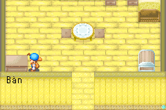
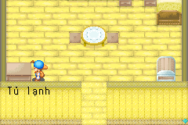

# Nhãn đồ vật tương tác — object-labels-01

Ngày 2026-10-24: thêm **261 nhãn tại 260 script**, tương ứng **68 tên tiếng
Anh**. Đếm theo vị trí chuỗi, không phải 261 loại đồ vật khác nhau. Các bản
sao trong nhiều nhà dùng cùng thuật ngữ. Tổng bản dịch nháp: 1.405/9.309 ID.

| English | Tiếng Việt |
| --- | --- |
| Table / Chair / Bench | Bàn / Ghế / Ghế dài |
| Bed / Big Bed | Giường / Giường lớn |
| Bookshelf / Shelf | Kệ sách / Kệ đồ |
| Refrigerator / Kitchen Cabinet | Tủ lạnh / Tủ bếp |
| Kitchen / Stove / Fireplace | Bếp / Bếp lò / Lò sưởi |
| Record Player / Mirror / Clock | Máy hát đĩa / Gương / Đồng hồ |
| Wood Box / Barrel | Thùng gỗ / Thùng |
| Feed Box / Tools | Máng ăn / Dụng cụ |

Các nhãn khác gồm tranh, cửa sổ, bình hoa, cây cảnh, hộp thư, đèn đường,
đồ nấu bếp, kệ rượu, lò luyện kim, xẻng và nhiều vật dụng khác. Danh sách
đầy đủ ở `localization/object_labels.json`, bản Anh ở
`localization/en/object_labels.json`, bản Việt trong `localization/vi/pilot.json`.
Glossary hiện có 471 thuật ngữ, gồm 66 mục mới; hai tên đã có được tái dùng.
Giữ nguyên spelling nguồn `Sopha`, chỉ bản Việt dùng `Ghế sofa` như Sofa.
Barrel không tự thêm vật liệu hoặc công dụng rượu khi nguồn không nói rõ.

## Xác minh nguồn

Danh sách ID là hợp đồng tường minh, không thay từ hàng loạt khi build.
`tools/object_text.py` kiểm từng literal English, string index, hash CODE của
260 script và các lệnh push index → OnCall 33/34/35. Chỉ các nhãn trong danh
sách mới được phân loại `interactive_object_label`, không gán NPC làm người
nói cho nhãn đồ vật. Không tự phân loại mọi chuỗi cạnh chúng.

Trong `asm/code_0803EE94.s` của StanHash/fomt, các nhánh native này lấy chuỗi
STR rồi gọi `0x0801268C`:

| OnCall | Nhánh native | Cờ text |
| --- | --- | --- |
| 33 | 0x080405DC | 0x100 |
| 34 | 0x0804053E | 0x40 |
| 35 | 0x0804058C | 0 |

Hash handler và jump-table slot cũng được kiểm. Sai CODE, literal, handler
hoặc display site sẽ bị từ chối. Contract chỉ lưu nguồn/bằng chứng, không
chứa bản Việt thứ hai có thể lệch với file translator đang sửa.

Riêng **Table trong ảnh người dùng** được tái hiện bằng điều khiển bình
thường và nối đến **script.0351.001**, nhánh khi chưa có máy hát đĩa. Bàn tròn
ở giữa nhà là **script.0355.000**. Cả hai hiện `Bàn` sau bản vá.

## Giữ nguyên sự kiện và logic

Có các nhãn nằm chung script với hội thoại hoặc cơ chế khác, chẳng hạn:

- 229: giường và sự kiện Cliff; chỉ index 5 là nhãn Bed.
- 335: tủ lạnh và thông báo Ngọc Sự thật; chỉ index 0 được chọn.
- 343: thoại giường/lời vợ người chơi; chỉ index 46 là Big Bed.
- 351: máy hát đĩa/bàn; hai index đều là tên đồ vật.
- 404: hội thoại cuộc thi; chỉ index 20 là Table.
- 483: khám bệnh; chỉ index 0 là Table.

Kiểm toàn bộ 260 script cho CODE/JUMP và số chuỗi giữ nguyên. **184 chuỗi
ngoài nhãn được chọn giữ nguyên byte**, kể cả lời NPC và nhánh sự kiện.
Chỉ trích/chèn đúng vị trí STR; không thêm tên đồ vật không có trong nguồn.

Các menu, lựa chọn, hướng dẫn dài, biển hiệu và nội dung tương tác khác nằm
ngoài các nhãn đã chọn vẫn theo dõi riêng. Ví dụ menu ngủ hoặc danh sách
sách không được coi là đã Việt hóa chỉ vì nhãn Bed/Bookshelf đã dịch. Không
khẳng định đã kiểm kê hết mọi vật thể, bản nâng cấp và map trong game.

## Kiểm thử native

```bash
make build ROM="$FOMT_ROM" PYTHON=.venv/bin/python
.venv/bin/python tools/object_labels_smoke.py build/fomt-vi-demo.gba \
  --base-rom "$FOMT_ROM" --library build/mgba_bridge-0.10.5.so
make platform-emulator ROM="$FOMT_ROM" PYTHON=.venv/bin/python
```

Hai tương tác tự nhiên cold boot từ SRAM trong game, không sửa tọa độ,
đồ đạc hoặc state RAM. Từ chỗ đứng sau khi load, A kiểm bàn tròn; khôi phục
state trong cùng lượt boot rồi đi xuống 54 frame, trái 94 frame và A để
kiểm bàn bên trái như ảnh. Kiểm đúng reader pointer và bitmap chữ `Bàn`.
SRAM đầu vào không bị sửa.

261 nhãn còn được kiểm qua fixture hộp thoại native đã khởi tạo trong nhà:
gọi setter có cờ đúng source, ẩn portrait/name, tạm tắt IME chỉ trong probe;
khôi phục CPU/IRQ/IWRAM trước khi chạy frame. Chuyển EWRAM của widget và
các cache liên quan, không chạy tiếp CPU từ function-probe trampoline.

Sau khi xóa cache, kiểm foreground trống; sau khi đến WAIT, **so chính xác
pixel foreground của cả ba hàng cache** với bitmap ASCII/Việt gốc, advance
8px và offset glyph +1. Như vậy kiểm được mất chữ, sai dấu, advance và clipping
trong cache, không chỉ con trỏ đã đi hết chuỗi. Có thêm 261 dòng renderer
với guard bộ nhớ. Không đổi font, màu, baseline, kích thước cửa sổ hay VRAM.

Fixture không chứng minh đã đi đến mọi nhà bằng gameplay. Hai bàn là phần
được kiểm bằng input tự nhiên; các nhãn khác chưa có chứng nhận tương tác tự
nhiên. Ngôn ngữ/bố cục thủ công và GBA thật vẫn pending.

[Báo cáo tại mốc object-labels-01](evidence/object-labels-validation.json) gắn hash ROM/IPS,
138 pytest, kết quả hai mGBA và ảnh. Bộ chuẩn v4 khóa 37 file, chạy chín suite
mỗi backend, vẫn giữ 43 ảnh chuẩn và kiểm round trip IPS/hai build độc lập.
Không dùng pixel fixture mới để tự ghi đè ảnh chuẩn cũ.

Ảnh tương tác tự nhiên với bàn trong ví dụ:



Ảnh kiểm nhãn Tủ lạnh bằng fixture native, nền vẫn là nhà người chơi:


