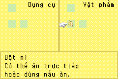
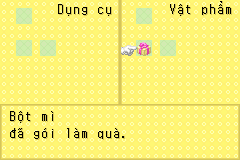
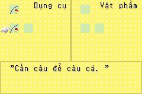

# Vật phẩm và UI — lô items-complete

Ngày 2026-10-23: đủ **347 tên và 347 mô tả có bản dịch nháp**. Số còn
thiếu đầu phiên thực tế là 310, vì lô 16 mô tả dụng cụ đã được thêm trước đó.
Thêm 26 chuỗi native: 17 thông báo cửa hàng và 9 nhãn/đơn vị cửa sổ vật phẩm.
Không đánh dấu `reviewed` chỉ nhờ kiểm thử kỹ thuật.

## Nguồn và thuật ngữ

Mỗi bản ghi giữ nguyên English, byte nguồn, địa chỉ và con trỏ từ ROM USA
A4NE rev 0. `tools/shop_text.py` liệt kê chính xác literal và từng vị trí
con trỏ đã đối chiếu assembly; byte hoặc con trỏ khác sẽ bị từ chối. Không
quét đoán chuỗi để chèn. `localization/en/shop_items.json` lưu 26 nguồn mới.

Nhãn `item.food.066.name` có lỗi chính tả **Flower** trong ROM. Bản dịch
**Bột mì** được xác minh bằng hai nguồn độc lập trong chính game:

- Bảng tạp hóa tại `0x080FDFA4` có bảy món food 63–69 theo thứ tự.
- Sách `script.1043.108`, đoạn “Here you can buy:”, liệt kê Rice Balls,
  Bread, Oil, **Flour**, Curry Powder, Muffin Mix, Chocolate cùng thứ tự.
- Food 66 ở vị trí thứ tư, giá 50G; icon 163 có hình túi bột trong cửa sổ thật.

Không sửa English gốc thành Flour. Glossary ghi alias này, thể lực, mệt mỏi,
bán, các máy chế biến và tên vật phẩm. Giữ tên đầy đủ tiếng Anh của ba quả
táo Won khi nguồn dùng chúng để giải thích chữ viết tắt. `Mì kiều mạch tempura` phân biệt với mì thường; R-P-S Ticket là `Vé oẳn tù tì`.

Hai lỗi nguồn được sửa có ghi nhận, không sửa ngầm metadata:

| ID | Nguồn | Bản dịch |
| --- | --- | --- |
| article.032.description | Tiêu đề Ruby nhưng tên vật phẩm và nội dung Topaz | Hoàng ngọc |
| article.010.description | Tiêu đề Wool(P) ở bản ghi Wool(X) | Len (X) |

Các bất thường chưa đủ chứng cứ để viết lại nội dung vẫn được giữ: mô tả
Silver Hammer bị cụt; grape juice nói wine; Moon Dumplings mô tả rau nướng.
Không tự thêm công dụng cho các slot unused. Token `{RAW:8166}` trong Rice
Cake được bảo toàn; dấu nháy legacy được kiểm bằng renderer native.

## Chèn và giới hạn bộ nhớ

Dữ liệu dịch được append ngoài 8 MiB; thay đúng các con trỏ đã xác minh.
ROM đích 16 MiB, phát hành IPS. Không thay icon, giá, thể lực/mệt mỏi hoặc
cờ thuộc tính trong bảng vật phẩm. `tools/item_audit.py` kiểm 347 cấu trúc
và bảng hàng/giá 13 hạt giống, 7 tạp hóa, 4 thuốc.

Bộ dựng mô tả dụng cụ có buffer `char[100]`, tối đa 99 byte trước NUL,
không phải 99 ký tự Unicode. `tools/item_window.py` bổ sung ngân sách từ
nguồn canonical: tối đa 95 byte cho mô tả dụng cụ cơ bản, 79 cho bình tưới,
chừa bốn byte dấu nháy, ba chữ số và tối đa 13 byte hậu tố nước. Bộ đếm bước
có trường số rộng 10; bình tưới rộng 3. Không thêm khoảng trắng thủ công để
thay glyph advance của font.

Nhánh title tại `0x080CF3B0` trong game tìm CR nhưng đi qua NUL nếu mô tả
không có CR (Fishing Rod). Hook Thumb có guard tám byte nguồn kiểm NUL trước
khi tăng con trỏ, dừng đúng kết thúc chuỗi. Giữ nguyên register/stack contract,
không thêm token giả vào bản dịch. Font, VRAM và kích thước cửa sổ giữ nguyên.

## Kiểm thử và giới hạn

`tools/item_audit.py` kiểm token, số cột, số byte, 724 pointer fields và
1.351 dòng qua bộ render native với guard bộ nhớ. `tools/item_ui_smoke.py`
cold boot từ SRAM trong game, khôi phục state nhà trước mỗi ca, đặt **RAM
fixture tạm** cho vật phẩm rồi dùng nút START/Right/A/R bình thường để mở
Ba lô. Không ghi save và không tuyên bố đã kiếm đồ hiếm bằng gameplay.

Ma trận gồm 347 cửa sổ thông tin và 266 cửa sổ tên quà gói. Máy đếm bước hiển thị bộ đếm thay mô tả; Ngọc Sự thật có nhánh
chỉ số riêng nhưng fixture hiện tại hiển thị mô tả thường, chưa kích hoạt
nhánh chỉ số. Nhãn thể lực/mệt mỏi được kiểm pointer và renderer độc lập. So chính xác foreground đen với glyph ở x=8/y=107, advance 8,
line stride 17. Hộp gốc có ba dòng và cuộn khi gặp LF, kể cả LF cuối: ghi riêng
các ca cuộn; không xóa control code để làm test qua. Mọi dòng, kể cả dòng đã
cuộn, còn được kiểm độc lập bằng renderer có guard. Đây chưa phải duyệt bố
cục thủ công hay chứng minh thấy mọi dòng cùng một lúc.

Báo cáo lô vật phẩm (hash mốc trước; kiểm lại trên target NPC trong platform-validation.json): [items-complete-validation.json](evidence/items-complete-validation.json).
Bộ chuẩn cũ 43 ảnh vẫn phải khớp pixel trên hai mGBA. Chưa kiểm giao dịch
mua/bán tự nhiên cho mọi nhánh, toàn bộ cửa hàng/NPC hoặc GBA thật. Duyệt nghĩa,
xưng hô, chất lượng bố cục và chơi thử tự nhiên vẫn nằm trong hàng đợi QA.

