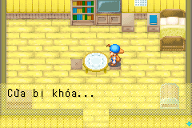

# Thông báo cửa khóa — 2026-10-24

Dịch toàn bộ 26 vị trí có literal `It's locked...{WAIT}` hoặc
`It's locked.{WAIT}` trong catalog đã trích. Bản Việt tương ứng là
`Cửa bị khóa...{WAIT}` và `Cửa bị khóa.{WAIT}`. Không suy đoán ngôi nhà từ
ảnh để chọn một ID duy nhất; áp dụng đủ các bản sao nguồn đã kiểm đếm.

Nguồn ở localization/en/locked_doors.json; bản Việt ở pilot.json. Contract
localization/locked_doors.json giữ literal, index, CODE hash và display call
OnCall33/34/35. Dùng lại verifier nguồn, guard handler native và công cụ
chèn hiện có. Không thay điều kiện cửa mở/khóa, giờ hoạt động hoặc gameplay.

146 test ROM đạt. Mỗi mGBA kiểm 26 UI fixture, 26 WAIT và 26 dòng renderer,
so bitmap foreground đầy đủ. CODE/JUMP ở 26 script không đổi; 47 chuỗi
không được chọn giữ nguyên byte, kể cả thoại xưng tội ở script 139. SRAM
không đổi; bản vá IPS áp lại đúng ROM đích.

Fixture dùng hộp thoại trong nhà làm host, không phải bằng chứng đã đi tới
mọi cửa bằng gameplay. Duyệt ngôn ngữ/bố cục thủ công còn pending. Bằng
chứng full-platform/golden cũ vẫn thuộc hash lịch sử.

[Báo cáo](evidence/locked-doors-validation.json).

