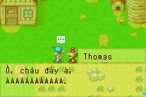
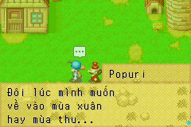
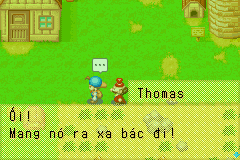
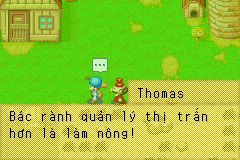

# Hội thoại thường ngày — npc-daily-01

Lô đầu của giai đoạn NPC thêm **85 bản dịch nháp**: 34 chuỗi chuẩn của Thomas
và 51 câu của Popuri. Đây chưa phải toàn bộ hội thoại NPC của game. Trạng thái
ngôn ngữ/bố cục vẫn pending, không tự đánh dấu reviewed.

## Phạm vi và xưng hô

| NPC | Nguồn ROM | Phạm vi đã dịch | Xưng hô |
| --- | --- | --- | --- |
| Thomas | script 1017, index 0–33 | 34/34 chuỗi trong script chuẩn: quà tặng, sinh nhật, hội thoại thường ngày | bác/cháu |
| Popuri | script 993, index 93–143 | 51 câu thường ngày: mưa, thăm quê vào mùa hè, nhắc các mùa, gia đình, làm việc, tình cảm | mình/bạn |

Popuri đã có lời chào index 0 từ trước, nên tổng là 52/144 chuỗi script 993.
**Index 1–92 chưa thuộc lô này**: có quà tặng, kết hôn, ở nhà, mang thai và
con nhỏ, cần tách điều kiện quan hệ và hồ sơ xưng hô trước. Không tự áp
mình/bạn cho vợ người chơi hoặc em/anh cho một câu chưa xác minh quan hệ.
Thomas giữ bác/cháu như phần mở đầu, kể cả lúc giận hoặc chê quà. Popuri
chỉ dùng mình/bạn trong đúng danh sách source ID đã bổ sung vào hồ sơ.

`localization/npc_coverage.json` phân biệt tổng script, số đã dịch, độ phủ
điều kiện và encounter tự nhiên. Script chuẩn không bao gồm mọi sự kiện,
lễ hội hoặc câu thoại NPC ở các script khác.

## Bằng chứng người nói và chức năng

`tools/npc_context.py` không suy người nói từ từ khóa tiếng Anh. Nó kiểm:

1. Literal script ID của constructor actor: Thomas `0x080361B8 = 1017`,
   Popuri `0x08035BFC = 993`, trong `asm/code_entities_08034CEC.s` của
   [StanHash/fomt](https://github.com/StanHash/fomt/tree/b8471ae065744869f64283473ed68372f82321c9). Constructor dùng chính ID đó làm script tương tác NPC.
2. SHA-256 nguyên CODE của hai script: Thomas
   `3b54ec6e358611a1dbc059c085e7dfe3abb48e94d75d20129b9644b73d1ac3ba`;
   Popuri `3f11878d5c486bf852cdadbfc40cfac3e3e4c6e5bbf815885c4a6a767c1d8bd9`.
3. Từng string index có lệnh push ngay trước OnCall 33. Nhánh native tại
   `0x080405DC` lấy chuỗi từ STR rồi gọi `0x0801268C` để hiện hộp thoại.
   Địa chỉ CODE của từng call được lưu ở `source.npc_context`.
4. Đối chiếu nhân vật với nội dung có tên/quan hệ đã xác minh: Thomas là
   thị trưởng, nhắc Harris; Popuri tự giới thiệu tại 993.000, nhắc mẹ,
   anh trai, Trại gia cầm và Kai. Đây là kiểm bổ trợ cho call-site, không
   dùng để gán mọi chuỗi nằm cạnh một tên người.

Nếu literal hoặc CODE khác, công cụ từ chối phân loại. English, byte nguồn,
STR index, pointer và token vẫn nguyên; catalog giữ 9.309 ID. Chỉ 85 ID được
chuyển khỏi `script_string_unclassified`, không gán hàng loạt các NPC khác.
Nguồn Anh có thể xem trong `localization/en/npc_daily.json`.

Bản gốc Popuri index 133 viết “quite men”; bản Việt hiểu theo ngữ cảnh là
“người trầm tính”, giữ nguyên English/byte nguồn để duyệt lại cách hiểu này.

## Điều kiện của Thomas

Bộ dò đọc trực tiếp bytecode gốc, từ dispatch CODE `0x7A2`, JUMP table 8,
đến trước phần cập nhật trạng thái `0xB2E`. Đây là trình thông dịch Python
phục vụ phân tích nhánh, **không phải** chơi game hay thay thế VM của ROM.
Ngữ nghĩa opcode lấy từ `src/script_engine.cc`, native query từ
`asm/code_0803EE94.s`:

- OnCall 20(13): mã bản đồ hiện tại của actor Thomas, qua `0x08012134`
  đọc halfword `AEntity +4`; không suy ra tên địa điểm từ câu thoại.
- OnCall 124(13): `GetFriendship`; 130(13): `HasBeenSpokenToJustNow`.
- OnCall 61(3): giờ, 61(6): giá trị thời tiết `GameState +8`.
- OnCall 47: biểu cảm/portrait; 33: hiện chuỗi. Không chạy phần ghi trạng thái.

| Mã bản đồ NPC | Điều kiện đã đọc | Index chuỗi |
| --- | --- | --- |
| 14, 15, 30 | friendship ≤100 / 101–200 / ≥201, nói lần đầu hay nói lại | 20/21, 22/23, 24/25 |
| 6 | friendship ≤100 hay >100, nói lần đầu hay nói lại | 26/27, 28/29 |
| 21 | friendship ≤100 hay >100, nói lần đầu hay nói lại | 30/31, 32/33 |
| 5 | từ 16 giờ | 14 |
| 5 | 13–15 giờ, weather=0 | 15 rồi 16 |
| 5 | 13–15 giờ, weather≠0 | 17 |
| 5 | 10–12 giờ | 18 |
| 5 | trước 10 giờ | 19 |

Kiểm 864 tổ hợp: sáu mã bản đồ NPC, sáu mốc friendship (0/100/101/200/201/255),
hai lượt nói, sáu giờ biên và weather 0/1; phủ 20 chuỗi index 14–33. Không
đổi mã bản đồ thành tên địa điểm nếu chưa đối chiếu bảng map của game.
Điều kiện quà tặng, story đặc biệt index 0–13 chưa replay tự nhiên.

Không xác lập được nhánh thường ngày riêng cho cả bốn mùa của Thomas trong
script này. Nhánh điều phối sang sự kiện mùa đông không được tính là đã dịch
sự kiện đó. Popuri có câu nhắc mưa và về quê mùa hè; **các câu nhắc mùa không
chứng minh điều kiện chọn thoại là mùa tương ứng**. Cổng quan hệ với Kai,
đám cưới, lịch, thời tiết và mùa của toàn bộ nhóm Popuri còn phải trace tiếp.

## Wiki tham khảo — lượt truy cập mạng khi tạo npc-daily-01

Ngày 2026-10-23 thử lại trang game FoMT, trang Thomas và `?action=raw` qua proxy
được cấu hình, dù quyền mạng đã mở. Website trả **HTTP 402** cùng nội dung
`Please contact the site owner for access.` Chưa nhận bài wiki nên không
nhập dữ kiện từ wiki hoặc tuyên bố đã đối chiếu thành công.

URL: https://harvestmoon.fandom.com/wiki/Thomas_(FoMT)

Tiếp tục dùng nguồn ROM/decomp cho lời thoại và ngữ cảnh; khi wiki đọc được,
chỉ đối chiếu bản GBA FoMT, không trộn remake hoặc More Friends of Mineral Town.

## Kiểm thử

```bash
.venv/bin/python tools/npc_context.py "$FOMT_ROM"
.venv/bin/python tools/localization_queue.py \
  --batch localization/qa/batches/thomas-daily-01.json
.venv/bin/python tools/npc_daily_smoke.py build/fomt-vi-demo.gba \
  --base-rom "$FOMT_ROM" --library build/mgba_bridge-0.10.5.so
make platform-emulator ROM="$FOMT_ROM" PYTHON=.venv/bin/python
```

Native UI fixture cold boot luồng tạo game, tên người chơi 12 ký tự, giữ hộp
thoại đang khởi tạo. Gọi setter native trong trạng thái cô lập, tạm tắt IME
để không có IRQ chen vào function probe; khôi phục toàn bộ CPU/IRQ/IWRAM
trước khi chạy frame. Chỉ chuyển các thay đổi EWRAM của widget **và các tile
cache bên ngoài**. Scratch tên nằm trong IWRAM của probe, không ghi lên tile
cache sống. Assert cả 21 cache 32×16 đã sạch trước khi vẽ, tránh chữ cũ chồng
lên chữ mới. Sau đó dùng frame và nút A bình thường để đi qua các WAIT.

Ảnh minh chứng là **fixture hộp thoại**, nền vẫn là cảnh mở đầu. Ẩn portrait
cảnh mở đầu để không thể hiện nhầm Popuri thành Thomas; nhãn người nói được
render bằng hàm native theo nguồn đã xác minh. Không coi ảnh này là encounter
NPC ở đúng lịch/địa điểm. Test kiểm 85 chuỗi, 124 điểm WAIT đúng pointer,
266 dòng render có guard (biến dự phòng 12 ô), SRAM không đổi và không lỗi
emulator. Các token CR/LF/PAGE/WAIT/VAR giữ đúng thứ tự gốc.

[Báo cáo](evidence/npc-daily-validation.json) ghi riêng kiểm nhánh nguồn,
renderer, fixture UI và giới hạn. Bản dịch vẫn nháp; chưa duyệt nghĩa/bố cục
thủ công, chưa kiểm toàn bộ dynamic name, quà tặng và encounter tự nhiên.

## Tiếp theo trong giai đoạn NPC

- Hoàn tất trace cổng mùa/quan hệ/lịch của Popuri, tách hồ sơ vợ người chơi
  khỏi bạn bè; xử lý index 1–92 theo nhánh đã xác minh.
- Tái hiện Thomas và Popuri tự nhiên trên save trong game, rồi ghi playtest
  gắn hash target; không nâng trạng thái dựa trên fixture.
- Mở NPC tiếp theo theo cùng chuỗi actor → script → ShowText → điều kiện →
  hồ sơ xưng hô → dịch → kiểm thử. Không dịch chuỗi chưa rõ chức năng/người nói.

Ảnh fixture hộp thoại native, không phải encounter tự nhiên:




## Tinh chỉnh Thomas — thomas-refinement-01

Áp dụng bốn thay đổi đã được người dùng chấp thuận, giữ bác/cháu:

| ID | Điều chỉnh |
| --- | --- |
| 1017.007 | “Ái chà!” → “Ối!”, rõ sắc thái giật mình của Yikes. |
| 1017.014 | “làng yên bình” → “thị trấn yên bình”, thống nhất địa danh. |
| 1017.018 | “thường cùng nhau” → “lúc nào cũng cùng nhau”, giữ nghĩa always. |
| 1017.023 | “rành việc làng” → “rành quản lý thị trấn”, sát running towns. |

Đã có tài liệu tham khảo do người dùng cung cấp ở thư mục cục bộ được Git
ignore; không phát hành tài liệu hoặc ZIP đó. English và token của ROM vẫn
là nguồn chính; không thêm lời thoại, tuổi, quan hệ tình cảm hoặc điều kiện
sự kiện từ tài liệu tham khảo. Đây là tinh chỉnh bốn nháp, không tăng số ID.

[Báo cáo tinh chỉnh](evidence/thomas-refinement-validation.json) lưu hash
ROM/IPS, kiểm token/độ rộng, năm điểm WAIT của bốn câu trên hai mGBA và ảnh
fixture native. Lượt chụp riêng dùng cùng npc_daily_smoke.py, chỉ lọc danh
sách bốn ID và chọn chụp ở WAIT đầu; giữ toàn bộ assert native/cache/SRAM.
Gate đầy đủ vẫn kiểm toàn bộ 85 câu và các suite nền tảng. CODE/JUMP của hai
script không đổi; 92 chuỗi Popuri ngoài phạm vi giữ nguyên byte.

Ảnh dưới đây là fixture hộp thoại native, chưa phải encounter tự nhiên:



