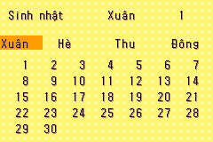
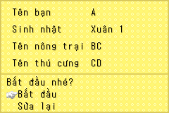
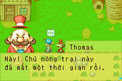
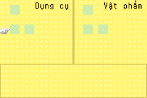
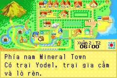
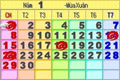
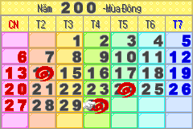
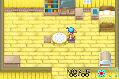

# Nền tảng Việt hóa — platform-v3-npc

Bộ chuẩn kỹ thuật ngày 2026-10-23 chốt font, bố cục và quy trình build đang có.
Không thay nét, màu, vị trí hoặc kích thước HUD trong phiên này. Đây vẫn là
bản Việt hóa thử nghiệm; bộ chuẩn không thay việc duyệt ngôn ngữ và chơi thử.

[Manifest bộ chuẩn](../localization/platform_baseline.json) khóa 34 file nguồn
và 43 ảnh framebuffer 240×160. Hash ROM tham chiếu là
`ee4fe9f95a91cf12462f0ec9326167affb6b84e581e7bb9e99b8cc304ea02766`.
Ảnh chuẩn kỹ thuật đã được kiểm bằng replay; việc người dùng duyệt toàn bộ
gallery về mặt thẩm mỹ vẫn pending. Không tự nâng các bản dịch lên reviewed.

Revision v2 thêm nguồn shop đã xác minh, giới hạn byte và sửa scanner NUL
cho Fishing Rod; 43 ảnh chuẩn giữ nguyên. Xem [chi tiết](ITEM_LOCALIZATION.md).

Revision v3 thêm phân loại NPC có guard, kiểm nhánh CODE và fixture hộp
thoại; vẫn giữ nguyên 43 ảnh chuẩn. Xem [NPC](NPC_DAILY_LOCALIZATION.md).

## Những thông số được giữ ổn định

| Hệ chữ | Quy ước |
| --- | --- |
| Hội thoại/menu thông thường | `native-outline-aligned-v2`; mask 8×16, advance 8px, baseline y=13; 95 ASCII và 134 chữ Việt |
| Bảng mã | `FOMT-VI-EB-v1`, mã Việt EB40–EBC5; JSON UTF-8 được encode khi build, ROM không đọc UTF-8 |
| Title | `native-thin-double-outline-v5`; nét mảnh, ngoài vào trong: đen → trắng → xanh #00DE73; canvas Bắt đầu 56×32, Tiếp tục 80×32 |
| Con trỏ title | `visible-left-edge-v1`; kiểm khoảng cách với mép chữ và chuyển lựa chọn |
| HUD ngày giờ | baseline y=6; bitmap a/â/e/è đã sửa; Hè giữ khoảng cách hiện tại; clock x=8/advance 8px theo hệ HUD gốc |
| Dấu trên HUD | tile overlay riêng, +1 OAM, +32 byte VRAM, +36 byte RAM; giữ khe hở giữa dấu và thân |
| Tiêu đề lịch | `vietnamese-calendar-heading-v19`; số năm raster 9×13, advance 10; khoảng từ 4px, nhóm 6px; texture 180/256 tile |
| Đồ họa khác | Giữ icon thời tiết, kích thước HUD và số ngày gốc; không anti-aliasing hoặc scaling mờ |

Các hệ chữ có metric khác nhau có chủ đích. Không áp advance 8px của hội thoại
vào artwork title hoặc HUD. Nguồn thiết kế nằm trong các module Python đã
khóa; không chỉnh riêng `encoding.json` để thay bitmap build.

Chi tiết: [font](VIETNAMESE_FONT.md), [HUD](HUD_ACCENT_OVERLAY.md),
[lịch](CALENDAR_HEADING.md), [START](START_MENU.md).

## Một lệnh kiểm nền tảng

```bash
export FOMT_ROM='/path/to/Harvest Moon - Friends of Mineral Town (USA).gba'
make platform-check ROM="$FOMT_ROM" PYTHON=.venv/bin/python

# Sau khi build hai adapter theo README_VI:
make platform-emulator ROM="$FOMT_ROM" PYTHON=.venv/bin/python
```

`platform-check` không cần mGBA. Nó xác minh hash nguồn và ảnh chuẩn, chạy
pytest với ROM USA hợp lệ, build hai lần độc lập, so byte ROM/IPS, đối chiếu
manifest phát hành và áp lại IPS để kiểm ROM đích. Không sửa bản vá phát hành.

`platform-emulator` làm các bước trên rồi chạy tám suite trên **cả** 0.10.5 và
0.11-dev: font/title/intro/save-load, tạo game, START, lịch/HUD, mô tả dụng cụ, audit toàn bộ vật phẩm và ma trận cửa sổ Ba lô và hội thoại NPC.
Mỗi báo cáo phải mang đúng hash ROM vừa build. Cuối mỗi backend, so toàn bộ
43 ảnh với chuẩn theo RGBA, không theo cách nén PNG, không cho phép sai pixel.
Ảnh diff đánh dấu tím cả lỗi màu lẫn lỗi alpha. Đây là kiểm tra cảnh cố định,
không phải nhận dạng chữ hay bằng chứng mọi hội thoại đều đúng.

Adapter cần có ở `build/mgba_bridge-0.10.5.so` và `build/mgba_bridge.so`.
Hai commit mGBA tham chiếu được ghi trong manifest; hướng dẫn compile trong
[README_VI](../README_VI.md). Báo cáo mỗi lượt ghi hash adapter thực sự dùng.
Lệnh không tự tải emulator hoặc ROM. Sau `make clean`, build lại adapter.

Replay START/lịch dùng `local-data/fixtures/day2.sram` đúng hash trong manifest.
Đây là fixture sinh từ save trong game, không phát hành trên Git. Nếu thiếu,
chạy `emulator_smoke.py` theo README, so hash `save-test.sram` vừa sinh với
`save_fixture.sha256` rồi sao chép vào đường dẫn fixture; sai hash phải điều
tra, không cập nhật manifest chỉ để test qua. Các replay cold boot từ SRAM,
không dùng savestate của ROM cũ. Save người dùng được giữ riêng.

Đầu ra duy nhất của lệnh nằm dưới `build/platform-check/`:

- `report.json`: kết quả lần chạy mới nhất, hash build/adapter và số pixel khác.
- `logs/`: log pytest, hai build và từng suite; lỗi trả exit code khác 0.
- `build-1/`, `build-2/`: ROM/IPS và insertion report để so byte.
- `0.10.5/`, `dev/`: ảnh replay, báo cáo suite, save thử và `diff/` nếu lệch.

Một lần kiểm không chạy emulator ghi rõ `emulator_replay_run: false`.
Nếu lần chạy mới thất bại, báo cáo cũ không được giữ trạng thái passed.
Lệnh không tự ghi đè ảnh chuẩn hoặc chấp nhận kết quả vừa sinh làm chuẩn mới.

## Ảnh đại diện

Tất cả ảnh dưới đây là framebuffer gốc, không phóng mờ. Danh sách đầy đủ
43 cảnh, vị trí ảnh và checksum nằm trong manifest.

| Cảnh | Ảnh chuẩn |
| --- | --- |
| Bắt đầu |  |
| Tiếp tục/con trỏ |  |
| Chọn sinh nhật, dùng Hè |  |
| Xác nhận tạo game |  |
| Intro Thomas |  |
| Menu Ba lô |  |
| Bản đồ |  |
| HUD Xuân |  |
| HUD Hè |  |
| Lịch năm 1 |  |
| Lịch năm 200 |  |
| Load save qua cold boot |  |

Bảy ảnh được cập nhật so với mốc lịch sử và một ảnh hội thoại Thomas bổ
sung được lưu trong `evidence/platform/`; 35 ảnh đã khớp được tái sử dụng
tại chỗ, không tạo thêm bản sao. Báo cáo lịch sử vẫn
giữ hash và ý nghĩa của mốc cũ, không coi ảnh cũ là ảnh của binary mới nhất.

## Khi cần thay đổi nền tảng

1. Tái hiện lỗi với ROM đúng hash và cảnh/input cụ thể; giữ ảnh trước/sau.
2. Sửa module font/bố cục hoặc pipeline; chạy suite liên quan để kiểm RAM,
   VRAM, pointer/control code và gameplay có thể bị ảnh hưởng.
3. Duyệt khác biệt có chủ đích. Đổi revision/hash khóa và đúng các ảnh bị
   ảnh hưởng trong manifest bằng một thay đổi có thể review; không nới ngưỡng.
4. Chạy lại hai build, IPS round trip và cả hai mGBA; ghi kết quả cùng hash
   vào báo cáo mới. Giữ bằng chứng lịch sử cần thiết và cập nhật tiến độ.

Dịch thêm bản ghi có thể đổi hash toàn ROM. `reference_target_sha256` ghi
nguồn gốc bộ chuẩn, không bắt mọi bản dịch tương lai phải có cùng hash này.
ROM mới vẫn phải khớp manifest phát hành hiện tại; các cảnh chuẩn chưa sửa
phải giữ nguyên pixel. Nếu dịch chính một cảnh chuẩn thì phải duyệt lại ảnh.

Chưa kiểm phần cứng GBA thật, toàn mùa hoặc mọi cửa sổ vật phẩm. Fixture năm
200 chỉ kiểm UI. Encounter Popuri và cửa sổ tự nhiên của đủ dụng cụ vẫn là
công việc QA còn lại, không được coi là đã hoàn thành nhờ bộ chuẩn này.
