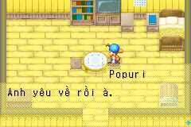
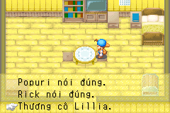

# Bốn sự kiện tim của Popuri — 2026-10-24

Đã dịch trọn **99 mục** ở script 36–39: 90 câu thoại và 9 lựa chọn, kể cả
mọi đoạn đáp lại lựa chọn tốt/xấu và đoạn kết phụ. Không bao gồm rival event
Popuri–Kai, sự kiện cưới hoặc mọi sinh nhật/lễ hội có Popuri.
Bản Việt nằm trong pilot.json; nguồn English/byte/địa chỉ ở
localization/en/popuri_heart_events.json. Không tự tạo thoại từ knowledge.

## Đối chiếu điều kiện với knowledge

Tài liệu riêng Fogu/Fandom được đọc làm ngữ cảnh; không đưa nguyên bài hoặc
archive knowledge lên GitHub. Bảng dưới là **điều kiện theo tài liệu tham
khảo**, chưa phải kết quả replay hoặc chứng minh đầy đủ activation gate ROM.
Không thay lịch/thời gian/tình cảm trong mã game để khớp bài hướng dẫn.

| Tim / script | Fogu | Fandom và khác biệt cần lưu ý |
| --- | --- | --- |
| Đen / 36 | Đường từ trại ra làng, thứ Tư/Sáu, 10h–18h; gợi ý ra khỏi lò rèn | Ra khỏi lò rèn, 11h–18h, tim đen trở lên. **Lệch giờ bắt đầu 10h/11h**, chưa chốt bằng activation gate ROM |
| Tím / 37 | Popuri tim tím, đến thăm trại buổi sáng; đồng ý là lựa chọn thứ hai; tour kết thúc khoảng 13h | Nắng, ra khỏi nhà 6h–12h, đã xem tim đen; có ghi chú ngoại lệ sau lễ hội gà, chưa xác minh trong ROM |
| Xanh / 38 | Chủ nhật 10h–13h tại nhà thờ, không mùa hè, ba lô lớn | Thêm trời nắng, ô trống, tim xanh và đã xem các sự kiện trước |
| Vàng / 39 | Vào trại gia cầm 10h–13h, không mùa hè | Tim vàng, đã xem các sự kiện trước, không thứ Ba/Chủ nhật; giữ đây là mô tả tham khảo, không suy từ thứ tự thoại |

Nguồn công khai để đối chiếu, không phải nguồn câu thoại ROM:
https://fogu.com/hm4/girls/popuri_black.htm,
https://fogu.com/hm4/girls/popuri_evep.htm,
https://fogu.com/hm4/girls/popuri_eveb.htm,
https://fogu.com/hm4/girls/popuri_evey.htm,
https://harvestmoon.fandom.com/wiki/Popuri_(FoMT).

## Xác minh người nói

`popuri_heart_events.py` kiểm từng literal, hash CODE/JUMP, lệnh gọi hiển thị
OnCall33 và lệnh tên OnCall44 trước nó. Native OnCall44 → 0x080126E4 →
0x0809FE3C đọc bảng tên tại **0x08104258**, stride 8:

| ID tên | Tên nguồn |
| ---: | --- |
| 1 | Lillia |
| 2 | Rick |
| 3 | Popuri |
| 5 | May |
| 16 | Stu |
| 22 | Carter |

Kiểm cả pointer table và literal tên, không gán người nói chỉ vì một câu
nhắc tên NPC. Lưu `speaker_sites` theo từng call-site. **38.002** dùng chung
cho cả Stu và May tại hai call-site: metadata ghi May / Stu, câu Việt trung
tính phù hợp cả hai. Fixture mẫu hiển thị một tên; không coi một snapshot
đơn lẻ là bằng chứng của cả hai lần gọi trong gameplay.

## Xưng hô theo cảnh

- Popuri với người chơi: mình–bạn; với Rick: em–anh; với mẹ: con–mẹ.
- Rick với người chơi: tôi–cậu khi cần, với Popuri anh–em, với mẹ con–mẹ.
- Lillia với người chơi: cô–cháu; với con: mẹ–con.
- Carter với người chơi và trẻ: cha–con.
- May và Stu với nhau: tớ–cậu; nói với Carter xưng con.
- Cảnh chơi gia đình: Popuri gọi người chơi anh, May/Stu gọi bố. Đây là
  **đóng vai**, không áp giọng vợ chồng cho toàn sự kiện hoặc coi đã kết hôn.

Câu 38.035 là Popuri nói khi người chơi từ chối, không phải Carter: dùng
“mình cũng hiểu mà”. 38.026 là May dỗ Stu: dùng “cậu”, không gọi Stu “em”.
Rick/Popuri không bị làm cho nặng lời hơn nguồn. Bản dịch giữ nét hồn nhiên
của cảnh chơi gia đình và sự lo lắng cho mẹ ở cảnh tim vàng.

38.026 chứa hai RAW:8166 (dấu nháy English). Chỉ vị trí này được thêm vào
ngoại lệ bỏ dấu nháy theo contract nguồn, cùng ba vị trí chuẩn đã có. Mọi
RAW khác, biến và CR/LF/PAGE/WAIT vẫn giữ nguyên thứ tự.

## Đủ lựa chọn và nhánh trả lời

OnCall39 tạo menu hai dòng; OnCall40 tạo menu ba dòng. Theo native widget,
giới hạn **26 byte** mỗi lựa chọn được cấp trong catalog. Tất cả lựa chọn
Việt đáp ứng giới hạn byte và glyph, không tăng bộ đệm.

| Script | Lựa chọn → CODE entry | STR trả lời trong block |
| --- | --- | --- |
| 36 | 1 “Có, mình thích.” → 996 | 11–13 |
| 36 | 2 “Không thích.” → 1703 | 14–16 |
| 37 | 1 “Mình đang bận!” → 155 | 3 |
| 37 | 2 “Được chứ.” → 349 | 4–7 |
| 38 | 1 “Mình chơi cùng nhé.” → 997 | 15–33 |
| 38 | 2 “Xin lỗi, mình bận.” → 2573 | 34–44 |
| 39 | 1 “Popuri nói đúng.” → 580 | 10–16 |
| 39 | 2 “Rick nói đúng.” → 1024 | 17–22 |
| 39 | 3 “Thương cô Lillia.” → 1418 | 23–28 |

`response_blocks` đối chiếu trực tiếp JUMP table sau từng menu và liệt kê
các ShowText trong block đáp lại. Đây là bản đồ vùng code phản hồi, không
phải giả lập toàn bộ động tác, điều kiện chờ hoặc tác động điểm tình cảm.
Không sửa nhánh tốt/xấu, quà tặng, thời gian kết thúc hoặc side effect.

## Kiểm thử và phần còn lại

152 test ROM đạt. Mỗi mGBA kiểm 90 fixture hội thoại / 114 WAIT / 235 dòng
renderer, so foreground đủ ba hàng khi chuyển trang/cuộn. Tên ASCII hiển
thị bằng setter native; portrait được ẩn để không gán mặt NPC khác. 4 CODE/
JUMP và số chuỗi giữ nguyên; toàn bộ 99 STR khớp bản dịch đã chọn.

Bốn native menu được kiểm riêng: so bitmap mọi nhãn (có khoảng chừa mũi
tên), thử Down và A cho đủ 9 lựa chọn, kiểm index 1/2/3 và trạng thái xác
nhận. SRAM giữ nguyên trên cả hai backend; IPS áp lại đúng ROM đích.

**Chưa** chứng nhận đã kích hoạt tự nhiên bốn sự kiện, chạy hết animation
và hiệu ứng điểm/quà của mọi nhánh. Điều kiện activation cần playtest/save
phù hợp hoặc phân tích event dispatcher riêng; các khác biệt wiki được giữ
rõ ở trên. QA ngôn ngữ/bố cục thủ công, GBA thật và rival events vẫn pending.
Full-platform/golden/Chromium cũ thuộc hash lịch sử, không coi là đã chạy lại
cho ROM này. Knowledge gốc vẫn ngoài Git.

[Báo cáo](evidence/popuri-hearts-validation.json).

