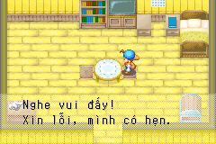
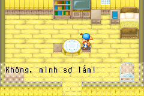

# Popuri — bản dịch có ngữ cảnh, 2026-10-24

Hoàn tất **144/144** mục trong script chuẩn 993 (142 câu Popuri, hai lựa chọn người chơi); cả dự án 1.597
bản dịch nháp. Đây không phải toàn bộ lời Popuri trong các sự kiện nhiều NPC.
Bản Việt ở pilot.json; contract nguồn ở localization/popuri_context.json.

## Cơ sở ngữ cảnh

Đối chiếu tài liệu riêng trong knowledge (Fogu và Fandom), không đưa bản gốc
lên Git. URL tham khảo: https://fogu.com/hm4/girls/popuri.htm và
https://harvestmoon.fandom.com/wiki/Popuri_(FoMT).

Popuri vui vẻ, thích động vật, muốn được đối xử như người lớn; Rick là anh
trai hay bao bọc cô. Lillia là mẹ, Rod là bố đang đi tìm cách chữa bệnh cho
mẹ. Popuri có thể kết hôn với người chơi hoặc Kai. Tài liệu Fogu ghi Lila,
nguồn game/Fandom dùng Lillia; không tự đổi tên riêng trong ROM theo bài web.

Wiki chỉ bổ sung ý nghĩa/quan hệ, không cung cấp thoại thay ROM. Nguồn thoại
là ROM USA hợp pháp; literal constructor 0x08035BFC xác định script 993,
hash CODE và từng push-index → OnCall33 được kiểm lại. Không đoán địa chỉ.

## Giọng nói và xưng hô

- Nói chuyện thông thường/quà dùng chung: mình–bạn, vui vẻ, tự nhiên.
- Câu rõ là vợ chồng, mang thai, nuôi con và gọi biệt danh hôn nhân:
  em–anh. Giữ nguyên VAR:29, VAR:2A và các biến khác, không thay bằng tên cố định.
- Với Rick: anh/anh trai; bố mẹ: bố/mẹ; Carter: cha Carter.
- Không áp em–anh cho toàn bộ 1..92: nhóm này còn có phản ứng quà,
  lời từ chối tình cảm và lời mời Lễ hội Đêm sao.
- Không tự suy ngưỡng tim, lịch hoặc điều kiện cưới từ thứ tự các chuỗi.
  Ngữ cảnh ngôn ngữ rõ trong lời thoại khác với chứng minh toàn bộ đường kích hoạt.

125 đổi ý “quấn lấy” thành “lo cho mình quá mức” để thể hiện sự bảo bọc của
Rick. 133 dùng “đẹp trai” thay “đẹp mã”, giữ sắc thái tình cảm nhẹ nhàng;
English `quite men` được hiểu là lỗi gõ của quiet trong câu đối chiếu vẻ ngoài
và tính trầm lặng, không sửa nguồn gốc. 136 gọi cha Carter phù hợp nhà thờ.

## Hoàn thiện năm mục cuối

005: “Thật sao? Quà sinh nhật / cho mình à? … Kể mẹ nghe chuyện này, /
chắc mẹ sẽ bất ngờ lắm!”; 021: “Không, mình sợ lắm!”; 092: “Em đang làm
việc chăm chỉ / vì anh đấy, {VAR:29}!”. Giữ CR/LF/PAGE/WAIT/VAR nguyên thứ tự.

RAW:8166 là dấu nháy phải ’, được kiểm bằng glyph native gốc và bản vá
(staging SHA256 trong báo cáo). Tiếng Việt không cần dấu nháy rút gọn English.
Chỉ 005/021/092 có quyền bỏ RAW:8166 trong catalog do popuri_text.py xác minh
constructor, literal và CODE; không lấy quyền từ metadata file bản dịch.
Mọi RAW khác và mọi biến/control vẫn nghiêm ngặt, số dấu nháy không được tăng.

038: **Nghe vui đấy!**; 039: **Xin lỗi, mình có hẹn.** Hai dòng là lựa chọn
của người chơi, không gán speaker Popuri. CODE 10386..10392 đẩy 3,38,39 rồi
OnCall39; handler 0x08040980 lấy hai STR và gọi native menu qua 0x080128D0.
Guard cả handler và widget 0x08050478..0x08050664. Widget dùng strlen, giới
hạn **26 byte** mỗi lựa chọn: câu có thêm “rồi” dài 30 byte và bị để trống.
Câu hiện tại dài 25 byte, đáp ứng cả giới hạn glyph và byte. Importer, queue,
editor cùng kiểm giới hạn nguồn này; không sửa renderer để nới bộ đệm.

Các heart/rival event, cưới/lễ hội nằm ở script khác vẫn chưa thuộc phạm vi
hoàn thành này. Không tuyên bố mọi lời Popuri trong game đã được dịch.

## Kiểm chứng

148 test ROM đạt. Hai mGBA kiểm 142 fixture hội thoại/196 WAIT/413 dòng
renderer, CODE/JUMP giữ nguyên. Hai lựa chọn còn được dựng bằng setter
native cùng đường gọi của OnCall39: so bitmap cả hai nhãn (kể cả khoảng
chừa mũi tên 16px), kiểm Down đổi lựa chọn 1→2, và A xác nhận từng dòng,
widget trở về state 0. SRAM không đổi.

Đây là UI fixture trong nhà, không phải tái hiện tự nhiên lời mời Đêm sao
hoặc chứng nhận các sự kiện sau khi chọn. Các biến dùng 12 chữ số để kiểm
layout; nguyên VAR vẫn nằm trong ROM. QA ngôn ngữ/bố cục thủ công, GBA thật
và toàn bộ nhánh sự kiện còn pending. Font/ảnh chuẩn cũ giữ nguyên; full
platform/golden trước đó là bằng chứng lịch sử, chưa chạy lại cho hash mới.

[Báo cáo hiện tại](evidence/popuri-complete-validation.json).
[Báo cáo 139 câu trước đó](evidence/popuri-validation.json) giữ hash lịch sử.

Bổ sung sau đó: bốn heart event người chơi đã có trọn 99 STR và các lựa chọn; xem [POPURI_HEART_EVENTS.md](POPURI_HEART_EVENTS.md). Rival/cưới/lễ hội khác vẫn theo dõi riêng.
