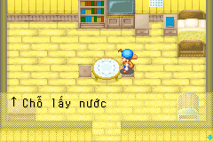
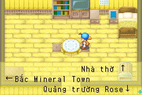
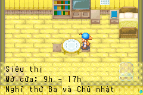

# Biển chỉ dẫn và thông báo — signs-01

Ngày 2026-10-24: dịch **48 mục tại 31 script**: 32 chuỗi biển/hướng dẫn,
13 thông báo lễ hội và ba nhãn hỏi/chọn chơi ném đĩa liên quan nội quy bãi
biển. Có 45 nội dung biển, không phải 48 biển vật lý khác nhau. Đây là toàn
bộ nhóm biển/thông báo tìm thấy trong đợt kiểm kê văn bản nguồn; chưa có
chứng nhận đã đi tới mọi biển ở tất cả map bằng gameplay.

| Nhóm | Source ID | Nội dung |
| --- | --- | --- |
| Nông trại | 158–164 | Kho thức ăn cho cá, chuồng ngựa, số gỗ/cỏ khô, lấy nước, thùng xuất hàng, cối xay |
| Suối nước nóng | 85, 490–491 | Lối vào, hồi thể lực/giảm mệt, luộc trứng |
| Quảng trường | 403.001–013, 405 | Thông báo lễ hội theo mùa và thùng rác |
| Bãi biển | 492–493 | Nội quy ném đĩa, lựa chọn chơi và quán Kai |
| Thị trấn | 494–510 | Giờ cửa hàng, nhà thờ, thư viện, phòng khám, trại gia cầm/Yodel, nhà nghỉ/đất trống, biển chỉ đường |

Các khoảng số trên là mô tả nhóm; **danh sách ID tường minh** nằm ở
`localization/signs.json`. Không dùng khoảng số để dịch tự động mọi chuỗi.
Biển trong ảnh người dùng là **script.0161.000**, nguồn
`{RAW:81AA}Water Drawing Spot{WAIT}`, nay hiện **↑ Chỗ lấy nước**.
Biển nhãn thùng xuất hàng script.0162.000 cũng được dịch sau khi xác minh
RAW:81A8 là mũi tên, tách biệt hướng dẫn bán hàng ở lô interaction-hints-01.

## Nguồn và kiểm kê

Extractor đọc ROM USA rev 0 hợp pháp, SHA1
`a2fc3574f0a65a4fcf7682fb274b9d7eebdef963`. Giữ English, original bytes,
địa chỉ và source reference trong `localization/en/signs.json`; bản Việt ở
`localization/vi/signs.json`. Không lấy nội dung biển từ wiki hoặc tự tạo
lịch mở cửa. Tên nông trại/người chơi và các bộ đếm vẫn là VAR gốc.

`tools/sign_text.py` kiểm literal, hash CODE, index và display call push →
OnCall33/34/35, dùng lại guard handler native đã có. Ba nhãn lựa chọn ở
492.001–003 được nối với chuỗi push 0,1,2,3 → OnCall36 tại CODE offset 616.
Chỉ các ID trong contract được phân loại sign_text/festival_notice/
frisbee_choice; không lan sang hội thoại cạnh chúng.

Nguồn có hai biến thể ngày nghỉ thư viện: **thứ Năm** và **thứ Hai**; đều
dịch riêng, giữ điều kiện CODE nguyên vẹn. Biển xưởng rượu ghi **nghỉ Chủ
nhật**, khác chuỗi mô tả bản đồ ghi thứ Bảy; lô này bảo toàn đúng thông tin
của từng nguồn, không âm thầm sửa gameplay/giờ mở cửa theo suy đoán.
`Swimming Festival` được giữ là **Lễ hội bơi lội**, cùng lời mời mang chó thi
ném đĩa như source, không đổi tên để che khác biệt nguồn.

Các ngày lễ, giờ sáng/chiều/nửa đêm, địa điểm và bản thông báo cuối năm kết
hợp năm mới đều giữ nghĩa nguồn. Dùng tên riêng Mineral Town, Mother's Hill,
Rose, Yodel, Aja, Kai, Mary, Doug và Saibara nhất quán. Glossary thêm 25 mục,
hiện 496 thuật ngữ; duyệt ngôn ngữ thủ công còn pending.

## Ký hiệu và khoảng cách

Đo bằng chính `func_080D0D28` của ROM gốc và bản vá: mười mã RAW được dùng
đều trả advance **16 px** và staging bitmap giống byte. Bao gồm:

- 8140: ô trống toàn chiều rộng; 8145: dấu chấm đầu dòng.
- 8175/8176, 8199, 81A1: dấu trang trí/đánh dấu nguyên bản.
- 81A8/81A9/81AA/81AB: mũi tên phải/trái/lên/xuống.

Giữ nguyên bitmap, màu và hướng mũi tên. Không chuyển ký hiệu sang font
Unicode và không thay hook font, baseline, HUD hoặc icon.

Hai biển **497.000 và 507.000** có nhiều RAW:8140 căn lề cứng, không đủ chỗ
cho tiếng Việt. Contract chỉ cấp `padding_reflow` cho hai ID này. Chúng được
giảm số ô trống RAW:8140; không được tăng số ô trống, đổi/bỏ mũi tên,
decoration, VAR, CR/LF/PAGE/WAIT hoặc thay thứ tự các token còn lại.

Validator mặc định vẫn nghiêm ngặt. Build trích lại ROM và chỉ lấy quyền
reflow từ `source.sign_context` đã xác minh; không tin metadata do file bản
dịch tự khai. Queue và bàn dịch dùng cùng luật. Một token trống bị mất ở
bản ghi khác vẫn là lỗi, giống trước đây.

Ở vài nhãn kết thúc bằng mũi tên, độ dài Việt đặt glyph rộng 16px vào ô cuối
của cache 32px, làm phần đầu mũi tên bị cắt. Thêm một khoảng cách trước mũi
tên tại 162.000, 497.000 và 498.000 để tránh ranh giới này; phép so toàn bộ
bitmap xác nhận cả đầu mũi tên còn nguyên. Không sửa renderer chỉ để xử lý
những vị trí này. Không tăng kích thước hộp thoại.

Hai bảng bộ đếm chuyển đơn vị lên tiêu đề để chừa đủ 12 ô dự phòng cho VAR.
`bushels` dùng đơn vị chung **phần** cho thức ăn trong game; không quy đổi
sang cân nặng/thể tích thật. Phần cối xay vẫn ghi 30 phần thức ăn cho gà.

## Kiểm thử và giới hạn

```bash
make build ROM="$FOMT_ROM" PYTHON=.venv/bin/python
.venv/bin/python tools/signs_smoke.py build/fomt-vi-demo.gba \
  --base-rom "$FOMT_ROM" --library build/mgba_bridge-0.10.5.so
make platform-emulator ROM="$FOMT_ROM" PYTHON=.venv/bin/python
```

- 31 script: CODE/JUMP và số chuỗi không đổi. Chuỗi cảnh báo dùng gỗ vàng ở
  403.000 không dịch trong lô này và giữ nguyên byte.
- 45 fixture widget native: so đủ bitmap foreground của ba hàng cache tại
  **73 điểm WAIT**, kể cả PAGE và cuộn dòng; chấp nhận đúng phép quay vòng
  cache của engine, không chỉ tìm thấy từ cuối cùng.
- **179 dòng** renderer có guard bộ nhớ; bỏ qua phép kiểm nonempty cho các
  dòng chỉ chứa ô trống, nhưng vẫn kiểm chúng trong widget thật.
- Mười RAW glyph so byte với ROM gốc. SRAM không đổi, emulator không báo lỗi.
- Ba lựa chọn ném đĩa kiểm bằng renderer và caller nguồn, chưa replay native
  choice widget. Ba chuỗi có VAR dùng 12 chữ số thay thế trong fixture IWRAM;
  xác nhận string thật trong ROM vẫn giữ VAR, không khẳng định đã kiểm giá
  trị mở rộng tự nhiên hoặc tình trạng bộ đếm cao nhất bằng gameplay.
- Fixture dùng hộp thoại trong nhà làm host; ảnh không chứng minh vật thể
  nằm trong nhà. Chưa có playtest tương tác tự nhiên cho cả nhóm biển.
- Duyệt ngôn ngữ/bố cục thủ công, mọi vật thể/map và GBA thật vẫn chờ QA.

Bộ hồi quy v5 khóa 42 file nguồn, chạy 11 suite trên mỗi mGBA, giữ 43 ảnh
chuẩn và kiểm hai build/IPS round trip. Bàn dịch còn có kiểm tra Chromium
trên bản sao dữ liệu. Kết quả gắn hash ở
[signs-validation.json](evidence/signs-validation.json), toàn bộ hồi quy ở
[platform-validation.json](evidence/platform-validation.json).







## Điều chỉnh cách ghi giờ — sign-hours-01

Theo yêu cầu người dùng, 25 mục đổi giờ số sang ký hiệu `h`: `9h - 17h`,
`11h - 13h`, `17h - 19h`; giờ đơn của thông báo lễ hội dùng `10h`/`18h`.
Nội quy biển dùng `6h - 17h`, quán Doug dùng `8h - 21h`; giờ thực tế và
ngày nghỉ giữ nguyên. Mốc nửa đêm vẫn giữ lời nguồn. Không đổi token,
font hay CODE/JUMP. Tổng số bản dịch vẫn 1.456.

Chạy 5 test ROM có sẵn cho nguồn/validator/queue/editor/build và cả hai
native sign suite: 45 nội dung/73 WAIT, 179 dòng renderer mỗi backend.
Hai build giống byte, IPS round trip đúng. Không chạy lại toàn bộ platform
cho thay đổi định dạng này; bằng chứng 144 test/43 ảnh chuẩn/Chromium ở
mốc signs-01 trước đó là lịch sử, không phải chứng nhận của hash mới.
[Báo cáo và ảnh mới](evidence/sign-hours-validation.json).
