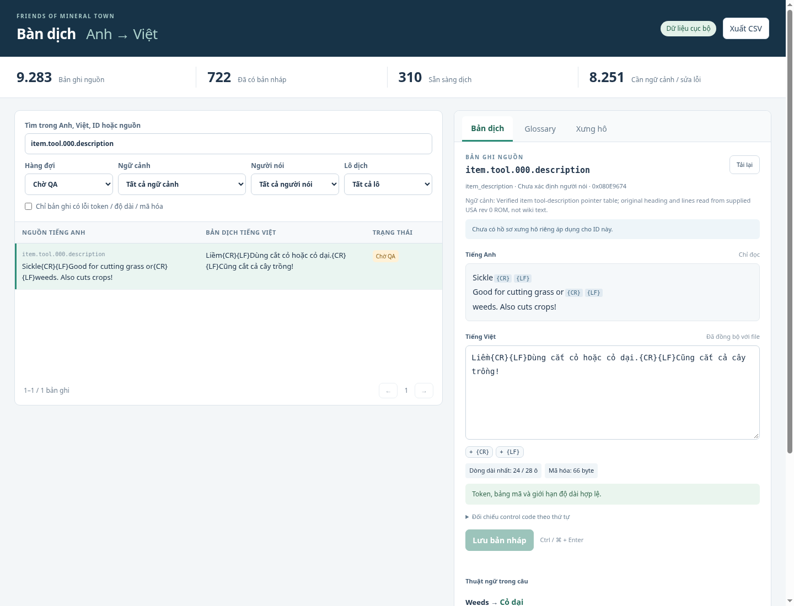
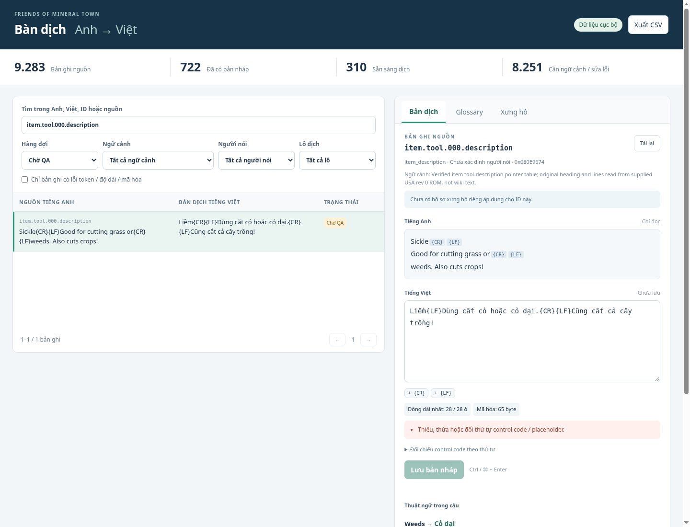

# Bàn dịch Anh–Việt

Công cụ chạy ở localhost, đọc catalog đã trích xuất và ghi trực tiếp vào các
file bản dịch đang được pipeline sử dụng. Không cần npm, dịch vụ dịch bên ngoài
hoặc ROM trong lúc biên tập. Công cụ chưa tự build/chạy game khi bấm Lưu.

## Mở công cụ

Tại thư mục project, sau bước extract trong [README_VI](../README_VI.md):

```bash
.venv/bin/python tools/translation_workbench.py
# Nếu cổng đang được dùng:
.venv/bin/python tools/translation_workbench.py --port 8766
```

Mở **đúng đường dẫn terminal in ra**, gồm phần `#token=…`. Server chỉ nghe
`127.0.0.1`; mã phiên được giữ trong tab trình duyệt, không lưu vào dữ liệu
dịch hoặc CSV. Khi khởi động lại server, dùng đường dẫn mới. Ctrl+C để dừng.
Runtime editor dùng Python 3.10+ trên Linux/POSIX và thư viện chuẩn; không
cần Node hoặc Chromium để sử dụng. Nếu chưa có `localization/en/catalog.json`,
chạy extractor với ROM USA hợp lệ trước. Catalog là đầu vào nguồn của editor;
bước build vẫn trích lại ROM để kiểm source và địa chỉ độc lập.



## Biên tập một lô

1. Chọn hàng đợi **Cần dịch**, **Chờ QA**, **Đang chặn** hoặc **Tất cả**.
   Lọc theo ngữ cảnh, người nói hoặc lô `tools-01` / `thomas-arrival`.
2. Tìm bằng Anh, Việt, ID hoặc source reference. Tìm kiếm không phân biệt
   hoa/thường hoặc dấu Việt. Bảng phân trang 50 bản ghi, không tải hết vào DOM.
3. Chọn dòng để xem toàn bộ tiếng Anh, địa chỉ/tham chiếu nguồn, bằng chứng
   ngữ cảnh và hồ sơ xưng hô áp dụng cho đúng ID. Tiếng Anh chỉ đọc.
4. Sửa bản dịch, giữ nguyên token như `{CR}{LF}`, `{WAIT}`, `{VAR:00}` theo
   nguồn. Các nút dưới ô nhập chèn token nguồn tại con trỏ; thêm thừa vẫn báo lỗi.
5. Sửa hết lỗi rồi bấm **Lưu bản nháp**, hoặc Ctrl/⌘+Enter. Không có autosave.
   Rời bản ghi hoặc đóng tab trình duyệt khi đang sửa sẽ được nhắc giữ hoặc bỏ nội dung chưa lưu.
6. Build và kiểm cửa sổ thật theo quy trình hiện có, sau đó duyệt QA riêng.

`Xuất CSV` lấy **toàn bộ kết quả của bộ lọc hiện tại**, không chỉ trang đang
hiển thị. CSV dùng UTF-8 BOM, giữ các trường nguồn/token/QA và vô hiệu hóa ô
có tiền tố công thức spreadsheet. CSV để đối chiếu; chưa có chức năng import CSV.

## Kiểm tra ngay khi nhập

- **Token:** so danh sách đầy đủ và đúng thứ tự, kể cả token lặp, VAR và RAW.
  Mục đối chiếu hiển thị cả chuỗi token nguồn và chuỗi token đang nhập.
- **Mã hóa:** dùng chính `fomt_text.encode`, chuẩn hóa NFC và báo ký tự chưa
  có trong bảng mã. Xuống dòng thật trong textarea không thay được `{CR}{LF}`.
- **Độ rộng:** dùng `check_translation` của pipeline; CR và LF có tác dụng
  riêng, WAIT không tự xuống dòng; biến dự phòng 12 ô như inserter.
- **Số byte:** đo số byte đã encode, kiểm `max_encoded_bytes` nếu nguồn có.
- **Tên riêng:** gợi ý glossary trong câu và nhắc tên riêng chưa được giữ.
  Gợi ý thuật ngữ là tham khảo, không tự thay văn bản hoặc ép cách dịch sai cảnh.

Thiếu/thừa token, ký tự không hỗ trợ, tràn giới hạn, bản dịch trống hoặc ngữ
cảnh chưa xác minh đều chặn lưu. Bộ kiểm không xác nhận dấu đã đẹp, chiều cao
không bị cắt hoặc hộp thoại thực tế không tràn; vẫn cần renderer/playtest.



Ảnh lỗi cố ý bỏ một `{CR}` trong bản sao kiểm thử; không sửa bản dịch thật.

## Glossary và hồ sơ người nói

Tab **Glossary** tìm trong 389 thuật ngữ hiện có và bảng tên riêng; hiển thị
category, trạng thái và source ID khi có. Quy tắc chung lấy trực tiếp từ
`localization/glossary.json`. Tab **Xưng hô** hiển thị bảy hồ sơ, phạm vi và
danh sách ID. Đây là phần tra cứu; chỉnh glossary/hồ sơ vẫn qua JSON và review.

Hồ sơ Thomas bác/cháu không tự áp lên mọi câu có nhãn Thomas. Editor chỉ gợi
ý hồ sơ khi ID có trong `source_ids`. Chuỗi chưa rõ ngữ cảnh và mục Flower
đang chặn chỉ được xem/xuất CSV; không có nút tự xác nhận ngữ cảnh hoặc QA.

## Lưu file và xử lý xung đột

File sở hữu bản dịch hiện có được giữ nguyên, gồm đủ sáu file VI. Mô tả vật
phẩm mới ghi vào `localization/vi/items.json`; bản ghi mới đã rõ ngữ cảnh
khác ghi vào `pilot.json`. Không tạo file nháp nằm ngoài danh sách build.
Các trường English/source/pointer/token/speaker không nhận từ form lưu.

Trước khi lưu, editor đọc lại dữ liệu, kiểm revision gồm nguồn/bản dịch/QA,
khóa ghi giữa các instance, giữ sửa đổi ở các ID khác và tạo backup nguyên file
tại `local-data/workbench/backups/<tên-file>-<sha256>.json`. Sau đó ghi file tạm
và thay thế nguyên tử. `make clean` giữ các backup này. Backup là toàn file;
khi phục hồi cần lấy đúng bản ghi để giữ các sửa đổi khác về sau.

Nếu cùng ID đã đổi, trả lỗi 409 và giữ nguyên ô đang nhập. Sao chép nội dung
cần giữ trước khi **Tải lại**, đối chiếu bản mới rồi lưu lại. Đây cũng là cách
xử lý khi English, nguồn hoặc registry QA của ID đó đã được chỉnh bên ngoài.

Lưu sửa đổi đặt trạng thái `translated`, kể cả bản trước là `reviewed`.
Registry QA không bị sửa; hash bản dịch thay đổi khiến các bằng chứng cũ
chuyển stale theo hàng đợi hiện có. Không tự duyệt ngôn ngữ, bố cục hoặc playtest.

## Kiểm thử lại

```bash
.venv/bin/python -m pytest -q tests/test_translation_workbench.py

# Tùy chọn: Node 22+ và Chromium có sẵn; không cần npm install.
node tools/workbench_browser_smoke.mjs
# Có thể chọn binary bằng FOMT_PYTHON và CHROMIUM.

make platform-check ROM="$FOMT_ROM" PYTHON=.venv/bin/python
```

Browser smoke tự tạo bản sao dữ liệu trong thư mục tạm, thử sửa/lưu/xung đột
và xóa bản sao khi xong; không chỉnh bản dịch gốc. Ảnh/báo cáo nằm trong
`build/workbench-browser/`. Nó kiểm cả giao diện 1440px, bố cục 390px, lỗi
token/độ dài/ký tự, backup, QA stale, glossary, hồ sơ, chặn Flower và CSV.
Đây là kiểm editor, không phải kiểm emulator. [Báo cáo phiên này](evidence/workbench-validation.json).
